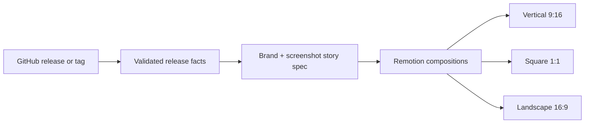

<!-- appfactory:hero:start -->
<div align="center">

# Release Video Engine

### Turn every release into a story worth watching.

**A reproducible release-to-video pipeline that transforms validated GitHub release content and product media into branded vertical, square and landscape MP4s.**

[](#repository-status)
[](#what-the-prototype-proves)
[](#from-release-to-video)
[](#from-release-to-video)

[**Pipeline**](#from-release-to-video) · [**Formats**](#what-the-prototype-proves) · [**Limitations**](#engineering-and-format-limits) · [**Use case**](#why-this-exists) · [**Demand**](#validation-gates) · [**Run**](#development) · [**Docs**](docs/video-template-contract.md)

</div>

---
<!-- appfactory:hero:end -->

## From release to video



**A release is source data, not a ready-made ad.** The adapter distinguishes published releases from fallback tags; the video template separates product identity, highlights, CTA and screenshots from its output frame. [Ingestion contract](docs/github-release-ingestion.md) · [Reusable video schema](docs/video-template-contract.md).

## What the prototype proves

The repository documents an **AgenFetch proof render** and supports output presets at 1080 × 1920, 1080 × 1080 and 1920 × 1080. Each intended H.264 MP4 is generated from a reproducible source spec; passing code checks does not replace watching the complete exported video.

## Engineering and format limits

**Prototype, not hosted publishing automation.** Social scheduling, multi-account billing, free-form text-to-video and commercial proof of demand remain out of scope. Render costs and quality must be measured, and claimed customers or pilot results must come from real validation. See [unit economics](docs/unit-economics.md) and [the outreach plan](docs/validation-offers-and-outreach.md).

Automated **release-to-video** marketing for SaaS and developer-tool teams.

The product turns GitHub releases, changelogs, screenshots and brand assets into deterministic, publish-ready videos for **9:16, 1:1 and 16:9** formats.

> CI/CD for product marketing.

## Why this exists

Shipping software is already automated. Communicating every release is not.

Product teams still spend time rewriting release notes, assembling screenshots, editing timelines, resizing content for social platforms and checking brand consistency. Release Video Engine explores a narrower workflow:

```text
GitHub release
    ↓
normalized release payload
    ↓
brand-safe video template
    ↓
Remotion render pipeline
    ↓
9:16 · 1:1 · 16:9 assets
```

The first business goal is **not** to build a full self-serve SaaS. It is to validate whether teams will pay for the outcome before expanding the platform.

## Initial customer

Primary ICP:

- SaaS founders;
- developer-tool teams;
- small product teams shipping frequently;
- teams without dedicated video-production capacity.

## MVP hypothesis

A user should be able to:

1. provide a public GitHub repository;
2. select a release;
3. provide screenshots and brand assets;
4. choose a branded video template;
5. generate release videos in multiple aspect ratios.

The first proof of concept uses **Remotion** for deterministic React-based video composition.

## Validation gates

The project moves forward only if evidence supports it.

### Gate 1 — Demand

- 20 qualified prospects contacted;
- at least 8 substantive responses or calls;
- at least 3 demo / pilot / pricing conversations.

### Gate 2 — Technical feasibility

- one release payload renders a polished 20–30 second video;
- the same payload renders 9:16, 1:1 and 16:9;
- no manual timeline editing is required;
- render duration and cost are measurable.

### Gate 3 — Commercial signal

- concierge pilot run with real prospects;
- at least one prospect reaches a paid-pilot or explicit procurement step;
- otherwise positioning, ICP or offer is revised before more platform work.

## Product principles

- **Outcome before platform** — sell the result before automating every step.
- **Deterministic over generative chaos** — brand consistency matters more than novelty.
- **One source, many formats** — content and brand data remain separate from composition code.
- **Evidence before scale** — no billing system, team management or complex dashboard before demand.
- **No fabricated proof** — no invented testimonials, logos, customer counts or performance metrics.

## Repository status

This repository was provisioned through **Trigenys AppFactory** as the initial go-to-market surface and product experiment.

Current phases:

```text
Discovery → Validation → Prototype → Pilot → Monetization → Scale
```

The GitHub backlog is managed with **AppFactory Project Automation**.

## Current stack

- React 19
- TypeScript
- Vite
- Tailwind CSS 4
- GitHub Actions
- AppFactory Project Automation

Prototype renderer:

- Remotion rendering engine
- shared release/brand contract
- deterministic 9:16, 1:1 and 16:9 composition registry

## Development

```bash
npm install
npm run dev
```

Validate:

```bash
npm run typecheck
npm run typecheck:video
npm run build
```

Render the AgenFetch proof release in all supported formats:

```bash
npm run render:agenfetch
```

Outputs are written to `out/` as deterministic H.264 MP4 files for vertical, square and landscape publishing. The render job logs per-format duration and output size, preserves successful files if another format fails, and returns a failing exit code after all formats have been attempted.

## What we are deliberately not building yet

- full video editor;
- generic text-to-video generation;
- social-media scheduler;
- billing infrastructure;
- agency workspace;
- complex account/team permissions;
- large template marketplace.

Those become relevant only after the release-to-video workflow proves demand.

## Ownership

Trigenys internal product experiment.
